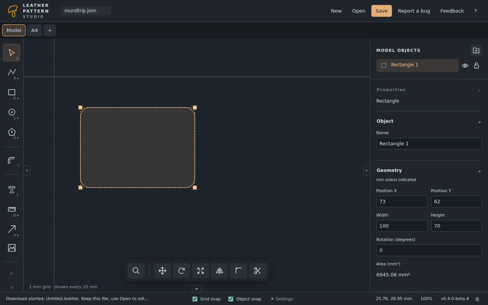
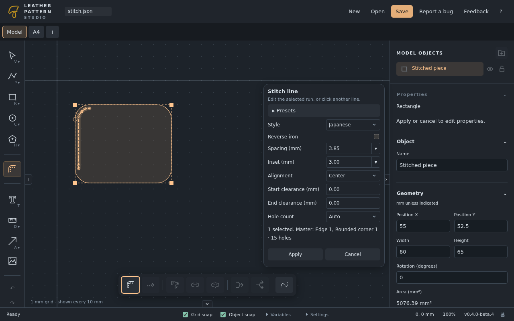
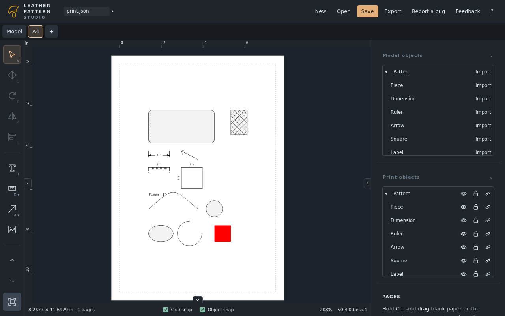

<p align="center">
  
</p>

# Leather Pattern Studio

**Pattern design made for leatherwork, from first outline to a paper pattern printed at actual size.**

General drawing apps don't know what a stitching iron is, and CAD tools take a weekend to learn. Leather Pattern Studio sits in between. You draw to exact dimensions, the stitch holes land where your irons will punch them, and the printout matches your ruler.

It's free and open source. It runs in your browser without an account, also comes as a desktop app, and works offline.

**[Open Leather Pattern Studio](https://leather.wieli.at)** · [User manual](https://leather.wieli.at/manual/index.html) · [Desktop downloads](https://github.com/wieli99/Leather-Pattern-Studio/releases)



## Exact dimensions, easy to change

Type in the dimensions you want and the shape follows. Every field takes formulas. Define a variable such as a strap width or a card slot depth, and every piece that uses it updates when you change it. That makes it easy to scale a wallet design to a new card size or a belt to a new length.

Rounded and chamfered corners, offsets, joins, cutouts, mirroring, arrays and alignment are all built in. Snapping and guidelines keep pieces lined up, and you can always zoom in for detail without the real size changing.

## Stitching that keeps up with your edits

Choose French, Japanese, round or flat holes and set the spacing and edge distance to match your irons. When you reshape a piece, its stitching follows the new outline. Merge stitch lines to keep the spacing even around corners. Link mating pieces, such as a gusset and its panel, and the editor tells you as soon as their hole counts drift apart.



Skiving, glueing and cutout areas get their own markings, so the pattern carries everything you need at the bench.

## Bring what you already have

Open an existing SVG pattern as editable outlines, with its stitch lines detected automatically. Got a photo or scan of an old pattern instead? Drop it in, mark two points a known distance apart, and trace over it at true scale.

## Print and cut

Lay your pieces out on print tabs as linked copies. When you change the pattern, the printout updates and your page layout stays as it is. Big pieces split across several sheets with assembly marks, and a size guide lets you confirm the scale at a glance. Export to PDF, SVG or PNG for printing, or to DXF for laser and plotter cutting.



## Get started

[Open the app](https://leather.wieli.at) and follow [Your first pattern](https://leather.wieli.at/manual/index.html#getting-started). In a few minutes you go from a blank canvas to a rounded, stitched piece ready to print. The full manual is one click away on the **?** button, offline included.

Projects are saved as `.leather` files on your own computer. Nothing is uploaded and you don't need an account.

Prefer a desktop app? Grab the build for Linux (Flatpak), Windows or macOS from [Releases](https://github.com/wieli99/Leather-Pattern-Studio/releases). It's available for both x64 and ARM64, and it tells you when a new version is out.

Ideas or feedback? Join the [Discussions](https://github.com/wieli99/Leather-Pattern-Studio/discussions), or use **Report a bug** right in the editor.

## Development

Leather Pattern Studio is built with Vue 3, TypeScript and Canvas 2D. A Rust document engine compiled to WebAssembly handles validation and undo history, and Tauri 2 powers the desktop app. Everything runs through Podman, so Bash and Podman are all you need:

```bash
tools/dev/run.sh dev     # serve the editor at http://127.0.0.1:5174
tools/dev/run.sh fast    # type check and unit tests
tools/dev/run.sh check   # Rust tests, production build and browser tests
```

See the [contributor guidelines](AGENTS.md), [architecture notes](docs/architecture.md) and [development workflow](docs/deployment.md) for more. Pull requests go to `dev`.

## License

[GNU General Public License v3.0](LICENSE).
