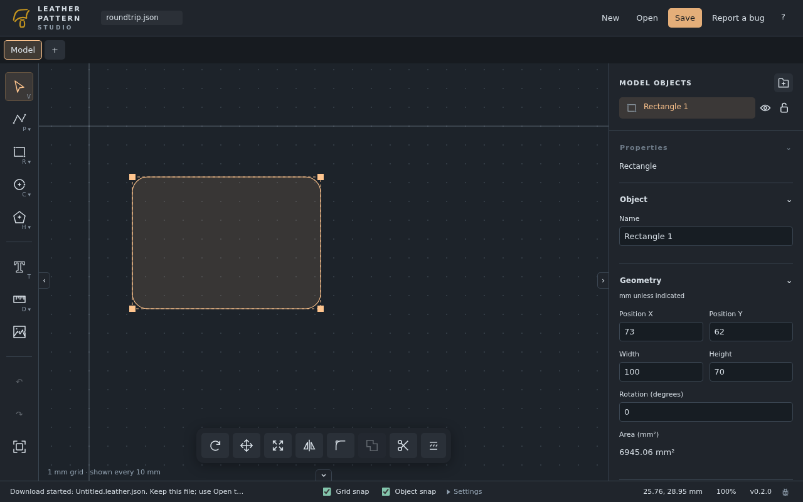
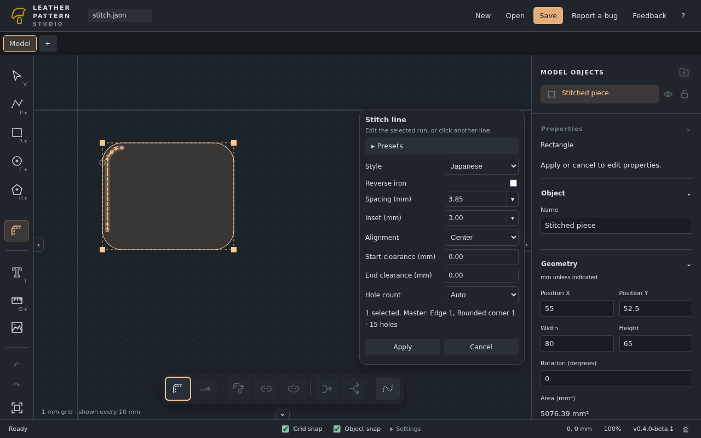
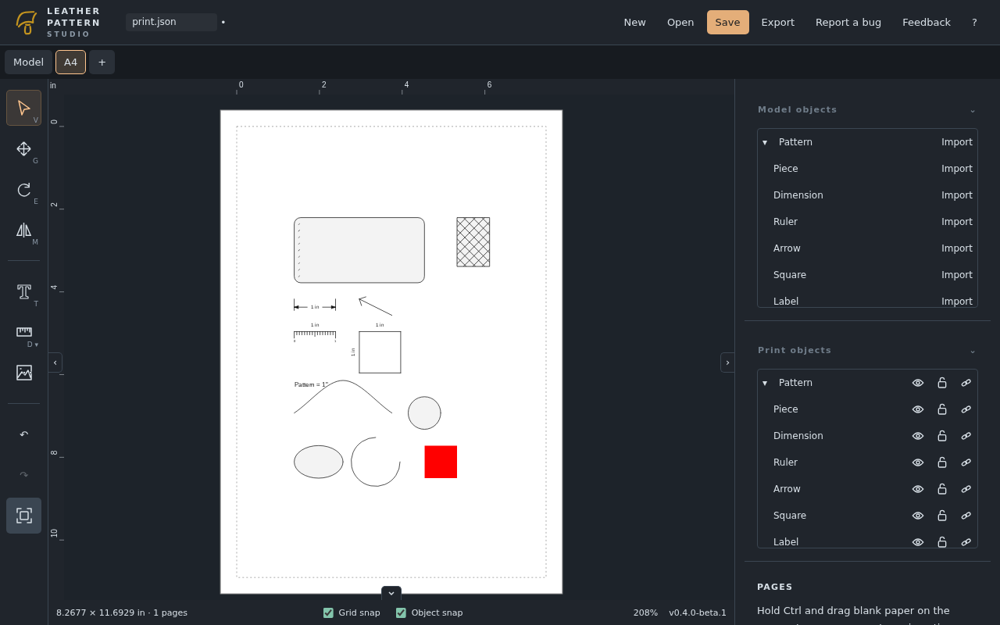

<p align="center">
  
</p>

# Leather Pattern Studio

**Draw accurate leather patterns, plan your stitching, and print at actual size — in your browser.**

Go from an idea to a paper pattern with precise dimensions, stitch-hole placement, and linked print layouts. No account or installation required. Your projects stay on your device, and you can keep working offline after the first online load finishes caching.

**[Open Leather Pattern Studio](https://leather.wieli.at)** · [User manual](https://leather.wieli.at/manual/index.html) · [Release notes](CHANGELOG.md)



## From outline to finished pattern

- **Draw to real dimensions.** Use numeric inputs, grid and object snapping, and measurements in millimetres or inches. Zoom in for detail without changing the size of your pattern.
- **Refine your pieces.** Edit curves, round corners, move, rotate, resize, mirror, trim, and merge geometry. Group related objects and add labels, measurements, and reference images.
- **Plan for leatherwork.** Mark skiving, glueing, and cutout areas, and add stitching with spacing and inset matched to your tools.
- **Keep paper layouts in sync.** Arrange linked copies of your pieces on print tabs. Source edits update the artwork while preserving its placement on the page.
- **Take your work with you.** Save editable `.leather.json` files and export print layouts as PDF, SVG, PNG, or outline-only DXF. The editor, manual, and exports work offline after caching completes.

### Stitching that follows your pattern

Choose French, Japanese, round, or flat hole marks, set spacing and distance from the edge, and merge adjacent stitch lines for continuous spacing around corners. Stitching follows edits to the source geometry. Link stitch lines to flag mismatched hole counts as you revise mating pieces.



[Explore stitching tools](docs/manual/stitching.md)

### Paper patterns ready for the workbench

Arrange pieces on standard or custom paper sizes, add labels and size guides, and spread larger patterns across sheets with assembly marks. Preview your export before downloading it. Print at **Actual size / 100%**, disable “Fit to page,” and check a printed size guide with a ruler before cutting material.



[Learn about print layouts and export](docs/manual/printing.md)

## Make your first pattern

1. [Open the app](https://leather.wieli.at) in a desktop browser and choose your units in Settings.
2. Draw a rectangle with exact dimensions, round its corners, and add stitch lines.
3. **Save** your editable project file.
4. Create a print tab with **+**, import your piece, add a size guide, and export a PDF.

Follow [your first pattern](https://leather.wieli.at/manual/index.html#getting-started) for a step-by-step walkthrough. The **?** link in the editor opens the bundled, searchable manual, which is also available offline. Manual sources live in [docs/manual](docs/manual/home.md).

## Project files and recovery

Projects save as version 21, including linked print layouts, embedded images, text, object groups, indicators, measurements, and attached stitch groups. Versions 1–20 migrate on open; older application builds cannot open version-21 files. Keep backup copies before upgrading.

Save/Save As use native browser file pickers where supported; other browsers download JSON copies. Browser recovery is separate from saved files and can be cleared or evicted. Save before accepting an application update.

## Current limitations

The desktop browser workflow is the validation target. CI exercises Chromium, Firefox, and WebKit on Linux; this does not certify physical Windows/macOS devices, native file dialogs, or touch/mobile editing. General-purpose booleans and offsets are outside the supported workflow. Offline use requires an initial successful online load and completed cache installation.

Bug reports may include project contents and system information. Review attachments before submitting a public GitHub issue. See the bundled manual for current procedures and limitations.

## Develop and contribute

Built with Vue 3, TypeScript, Canvas 2D, and Rust/Wasm, with a focused 2D workspace inspired by Plasticity.

### Run with Podman

```bash
tools/dev/run.sh dev
```

Open **http://127.0.0.1:5174/**. This builds the Node/Rust toolchain image, installs locked dependencies, generates Wasm, and starts Vite. Stop another server using port 5174 first. Source changes reload; Rust changes require rerunning `npm run wasm` in the container.

```bash
tools/dev/run.sh check
```

Runs Rust tests, generated TypeScript contracts, production build, unit tests, and Chromium/Firefox/WebKit acceptance tests. Browser system libraries are baked into the cached development image, using the locked Playwright version, so individual test containers retain the required libraries. Browser binaries use a persistent Podman volume; `check` installs any missing binaries. To test offline behavior, build and run `tools/dev/run.sh preview`; development mode intentionally does not register a service worker. Offline use starts after the first successful online load and cache installation. Serve deployments over HTTPS (localhost also works).

See the [contributor guidelines](AGENTS.md) and [development and release workflow](docs/deployment.md) for contribution and pull request guidance.

### Code organization

`src/editor/` contains the controller, renderer, worker client and persistence; `src/model/` contains migration and geometry helpers; `crates/document/` owns validated documents and history in Rust/Wasm. `src/generated/` contains Rust-generated TypeScript contracts; `src/wasm/` is generated and ignored. The Tauri shell remains optional and is not required for browser delivery.

## License

[GNU General Public License v3.0](LICENSE).
